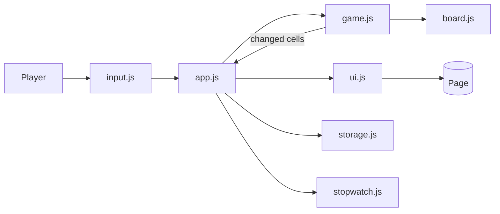
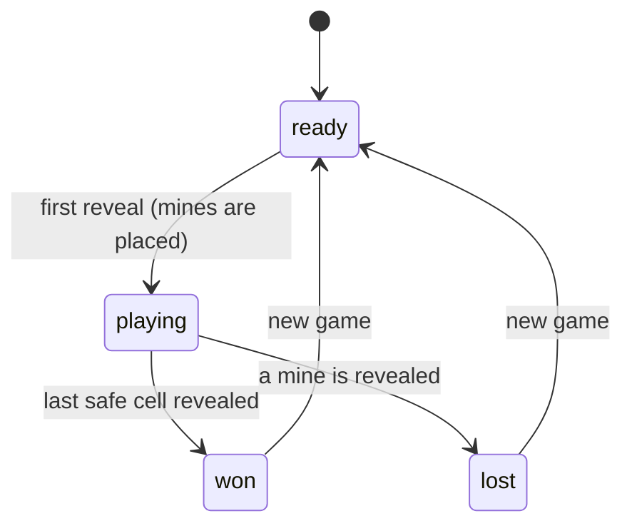

# 💣 Minesweeper

A complete, dependency-free **Minesweeper** built with vanilla **HTML, CSS and JavaScript**. It has three difficulty levels, a guaranteed-safe first click, flood-fill reveals, flagging, chording, a timer, saved best times, touch and keyboard support, and a unit-tested game engine.

No frameworks, no build step, no images, no fonts to download and no network access needed: the whole game works offline.

---

## Table of Contents

1. [Features](#features)
2. [How to Play](#how-to-play)
3. [Controls](#controls)
4. [Difficulty Levels](#difficulty-levels)
5. [Tech Stack](#tech-stack)
6. [Project Structure](#project-structure)
7. [Getting Started](#getting-started)
8. [Architecture](#architecture)
9. [Algorithms](#algorithms)
10. [Accessibility](#accessibility)
11. [Testing](#testing)
12. [Deploying to GitHub Pages](#deploying-to-github-pages)
13. [Browser Support and Known Limitations](#browser-support-and-known-limitations)
14. [Commit History Guide](#commit-history-guide)
15. [Roadmap](#roadmap)
16. [Contributing](#contributing)
17. [License](#license)

---

## Features

- Three classic difficulty levels: **Beginner**, **Intermediate** and **Expert**
- **First click is always safe** and always opens an empty area, because mines are placed after you click
- Automatic **flood-fill** reveal of empty regions
- **Flagging** with right-click, long-press on touch screens, the `F` key or a **Flag mode** toggle
- **Chording**: click a number whose flag count matches to open all its neighbours at once
- Mine counter (it can go negative, like the original), timer and an expressive **face button** (🙂 😮 😎 😵)
- **Best time** for every difficulty, saved in your browser
- Wrong flags are marked at the end of a lost game, and mines are auto-flagged when you win
- Full **keyboard play** with arrow keys, `Enter`, `F` and `R`
- Responsive layout: the cell size adapts to the screen, and the board scrolls sideways if it still does not fit
- Win and lose animations that respect `prefers-reduced-motion`
- Unit tests for every rule of the game

---

## How to Play

The board is a grid of hidden squares. Some of them hide mines. Your goal is to reveal every square that does **not** contain a mine.

1. Click any square to start. Your first click is always safe.
2. A revealed number tells you how many of the eight surrounding squares contain a mine.
3. Use the numbers to work out where the mines are, and **flag** squares you are sure about.
4. Reveal a mine and the game is over. Reveal every safe square and you win.

### Reading the numbers

| Number | Meaning                                  |
| ------ | ---------------------------------------- |
| blank  | No mines nearby (the area opens up)      |
| 1 to 8 | Exactly that many mines in the 8 squares around it |

### Chording

When a revealed number already has the right number of flags around it, click the number. All its remaining hidden neighbours open at once, which saves a lot of clicking. Be careful: if one of your flags was wrong, the game is lost.

---

## Controls

| Action                         | Mouse                    | Touch                       | Keyboard            |
| ------------------------------ | ------------------------ | --------------------------- | ------------------- |
| Reveal a square                | Left-click               | Tap                         | `Enter` / `Space`   |
| Place or remove a flag         | Right-click              | Long-press, or Flag mode    | `F`                 |
| Chord on a number              | Left-click the number    | Tap the number              | `Enter` / `Space`   |
| Move between squares           |                          |                             | Arrow keys          |
| New game                       | Click the face           | Tap the face                | `R`                 |
| Change difficulty              | Click a difficulty button | Tap a difficulty button     | `Tab`, `Enter`      |

**Flag mode** (the 🚩 button under the board) makes every tap place a flag instead of revealing, which is handy on phones.

---

## Difficulty Levels

| Level        | Grid    | Mines | Mine density |
| ------------ | ------- | ----- | ------------ |
| Beginner     | 9 × 9   | 10    | 12.3%        |
| Intermediate | 16 × 16 | 40    | 15.6%        |
| Expert       | 16 × 30 | 99    | 20.6%        |

Your last chosen difficulty is remembered, and each level keeps its own best time.

---

## Tech Stack

| Layer       | Technology                                  |
| ----------- | ------------------------------------------- |
| Markup      | HTML5 (semantic elements, ARIA attributes)  |
| Styling     | CSS3 (custom properties, grid, keyframes)   |
| Logic       | Vanilla JavaScript (ES2015+)                |
| Persistence | Web Storage API (`localStorage`)            |
| Testing     | Node.js built-in test runner (`node:test`)  |

---

## Project Structure

```
minesweeper/
├── index.html           # Page structure: HUD, board container, controls
├── css/
│   ├── style.css        # Theme, layout, LCD counters, controls
│   ├── board.css        # Cells, numbers, flags and mines
│   └── effects.css      # Status colors, animations, responsive rules
├── js/
│   ├── config.js        # Difficulty presets and constants
│   ├── rng.js           # Seeded random number generator
│   ├── board.js         # Grid helpers and safe mine placement (pure logic)
│   ├── game.js          # The rules: reveal, flag, chord, win, lose (pure logic)
│   ├── format.js        # LCD counter and time formatting
│   ├── stopwatch.js     # Timestamp-based stopwatch
│   ├── storage.js       # Safe localStorage for best times and difficulty
│   ├── ui.js            # All DOM updates
│   ├── input.js         # Mouse, touch and keyboard handling
│   ├── app.js           # Controller that connects everything
│   └── main.js          # Entry point
├── tests/
│   ├── rng.test.js
│   ├── board.test.js
│   ├── game.test.js
│   ├── format.test.js
│   ├── stopwatch.test.js
│   └── storage.test.js
├── package.json
├── .gitignore
└── README.md
```

---

## Getting Started

### Prerequisites

- Any modern web browser
- (Optional) [Node.js](https://nodejs.org/) 18 or newer, only needed to run the tests

### Run the game

```bash
git clone https://github.com/<your-username>/minesweeper.git
cd minesweeper
```

Then open `index.html`:

```bash
# Windows
start index.html
# macOS
open index.html
# Linux
xdg-open index.html
```

You can also use the VS Code **Live Server** extension, or any static server such as `python -m http.server 8000`.

---

## Architecture

The code is split so that **the rules of the game know nothing about the page**, and the page knows nothing about the rules.

| Module         | Responsibility                                  | Touches the DOM? |
| -------------- | ----------------------------------------------- | ---------------- |
| `config.js`    | Constants and difficulty presets                | No               |
| `rng.js`       | Repeatable random numbers                       | No               |
| `board.js`     | The grid, neighbours, mine placement            | No               |
| `game.js`      | Rules, game state, win and lose                 | No               |
| `format.js`    | Turn numbers into text                          | No               |
| `stopwatch.js` | Elapsed time                                    | No               |
| `storage.js`   | Validate, load and save records                 | No               |
| `ui.js`        | Draw cells, counters and messages               | Yes              |
| `input.js`     | Turn events into callbacks                      | Yes              |
| `app.js`       | Decide what happens, tell the UI what to draw   | Via `ui.js`      |
| `main.js`      | Create objects and attach listeners             | Yes              |

Each file is wrapped in an IIFE and exports through `module.exports` (Node) or the `window.Mines` namespace (browser). This avoids ES modules, which browsers block when a page is opened from `file://`.

### Data flow



Every action in `Game` (`reveal`, `toggleFlag`, `chord`) returns the list of cells that changed, so the screen only redraws those cells. At the end of a game it returns every cell, so mines and wrong flags appear.

### Game states



### The screen never learns where hidden mines are

`Game.cellInfo(r, c)` reports a mine **only when the cell is revealed**, so the UI cannot leak (or be tricked into showing) hidden information, and the logic stays separate from the display.

---

## Algorithms

### Safe first click

Mines are not placed when the page loads. They are placed on the **first reveal**, in `placeMines` (`board.js`):

1. The clicked cell and its 8 neighbours are marked protected, so the first click always opens an empty area.
2. If the board is too crowded to protect all 9 cells (not the case for the presets), only the clicked cell is protected.
3. The remaining cells are shuffled with a **partial Fisher-Yates shuffle** and the first `n` become mines, so every allowed cell is equally likely and no cell is picked twice.
4. Neighbour counts are computed once.

### Flood fill

Revealing a cell with no neighbouring mines opens the whole connected empty region plus its numbered border. `floodReveal` uses an explicit **stack** instead of recursion, so even a nearly empty large board cannot overflow the call stack. Flagged cells are skipped, as in the original game.

### Chording

`chord(r, c)` only works on a revealed number whose count equals the number of flags around it. It then reveals every unflagged, hidden neighbour. If one of them is a mine (a wrong flag), the game is lost, exactly like the classic game.

### Win detection

A win is declared when the number of revealed cells equals `rows × cols − mines`. Flags are not needed to win, and a wrongly flagged safe cell stays hidden, so it must be unflagged first.

### Seeded random numbers

`rng.js` implements a small seeded generator (mulberry32). The game uses `Math.random` by default, but tests inject a seed so that boards are exactly reproducible.

---

## Accessibility

- Every cell is a real `<button>` with a descriptive `aria-label` ("Row 3, column 5, 2 adjacent mines")
- Full keyboard play: arrow keys move between cells, `Enter`/`Space` reveal, `F` flags
- Only one cell is a `Tab` stop, so keyboard users do not have to tab through up to 480 buttons
- Status messages are announced through a polite live region
- Visible focus rings
- Numbers use distinct colors, and flags and mines also use symbols, so meaning never depends on color alone
- `prefers-reduced-motion` turns off animations

---

## Testing

The game rules and helpers are covered by unit tests using Node's built-in test runner, so there is nothing to install:

```bash
npm test
```

(or simply `node --test`)

| Test file            | What it covers                                                                      |
| -------------------- | ----------------------------------------------------------------------------------- |
| `rng.test.js`        | Same seed gives the same numbers, range `[0, 1)`, even distribution                 |
| `board.test.js`      | Board creation, neighbours, counts, mine placement, protected first click, crowded boards |
| `game.test.js`       | First click safety, flood fill, flags, chording, winning, losing, locked board after the end |
| `format.test.js`     | LCD padding, clamping, negative numbers, time labels                                |
| `stopwatch.test.js`  | Counting, stopping, resuming, capping, resetting                                    |
| `storage.test.js`    | Best-time records, corrupt data, missing storage, saved difficulty                  |

The tests use `Game.fromLayout(...)` to build boards with mines in known positions, so every rule is checked against a board small enough to verify by hand.

### Debugging in the browser

Open the console and use the `minesweeper` object:

```js
minesweeper.game.board.cells.filter(c => c.mine).length  // number of mines
minesweeper.game.status                                   // ready | playing | won | lost
```

---

## Deploying to GitHub Pages

Because this is a static site, deployment is free:

1. Push the repository to GitHub.
2. Go to **Settings → Pages**.
3. Under **Build and deployment**, choose **Deploy from a branch**.
4. Select the `main` branch and the `/ (root)` folder, then save.
5. After a minute the game is live at `https://<your-username>.github.io/minesweeper/`.

---

## Browser Support and Known Limitations

Works in current versions of Chrome, Edge, Firefox and Safari on desktop and mobile. It needs ES2015 classes, CSS grid and pointer events. The game still runs without `localStorage`, it just cannot remember best times.

- On a phone, the **Expert** board is wider than the screen and scrolls sideways. Beginner and Intermediate fit.
- The emoji used for mines, flags and the face look slightly different on each operating system.
- The timer counts from your first reveal and does not pause when you switch tabs.
- A very first click on a heavily crowded custom board only protects the clicked square (not relevant to the three presets).

---

## Commit History Guide

The project was built module by module, one commit per step:

| #  | Type    | What it added                                                        |
| -- | ------- | -------------------------------------------------------------------- |
| 1  | `chore` | Repository initialization and `.gitignore`                           |
| 2  | `docs`  | Initial README skeleton                                              |
| 3  | `feat`  | HTML structure: HUD, board container, difficulty selector            |
| 4  | `style` | Theme, layout, LCD counters, face button and controls                |
| 5  | `style` | Board cells, number colors, flags and mines                          |
| 6  | `feat`  | Configuration and difficulty presets                                 |
| 7  | `feat`  | Seeded random number generator                                       |
| 8  | `feat`  | Board helpers with safe first-click mine placement                   |
| 9  | `feat`  | Game rules: flood fill, flags, chording, win and lose                |
| 10 | `test`  | Unit tests for the random generator, board and game                  |
| 11 | `feat`  | LCD counter and time formatting                                      |
| 12 | `feat`  | Timestamp-based stopwatch                                            |
| 13 | `feat`  | Safe `localStorage` for best times and difficulty                    |
| 14 | `test`  | Unit tests for formatting, stopwatch and storage                     |
| 15 | `feat`  | UI module                                                            |
| 16 | `feat`  | Input handling: click, right-click, long-press, keyboard             |
| 17 | `feat`  | App controller                                                       |
| 18 | `feat`  | Entry point                                                          |
| 19 | `style` | Status colors, win and lose animations, responsive rules             |
| 20 | `chore` | `package.json` with `test` script                                    |
| 21 | `docs`  | This detailed README                                                 |

Commit messages follow the [Conventional Commits](https://www.conventionalcommits.org/) style.

---

## Roadmap

- [ ] Custom board size and mine count
- [ ] Question-mark marks (a third cell state)
- [ ] Sound effects with a mute toggle
- [ ] "No guessing" boards that can always be solved by logic
- [ ] Hint button that reveals a guaranteed-safe cell
- [ ] Daily challenge using a shared seed
- [ ] Light theme
- [ ] Installable PWA with offline support

---

## Contributing

Contributions are welcome.

1. Fork the repository
2. Create a feature branch: `git checkout -b feat/my-feature`
3. Make your changes and run `npm test`
4. Commit with a clear message: `git commit -m "feat: describe your change"`
5. Push and open a Pull Request

---

## License

This project does not include a license file. Unless the author adds one, all rights are reserved.